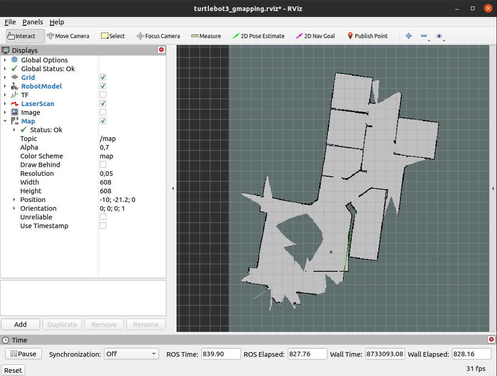
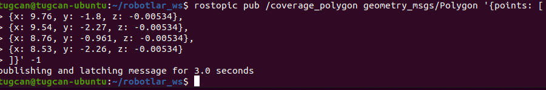
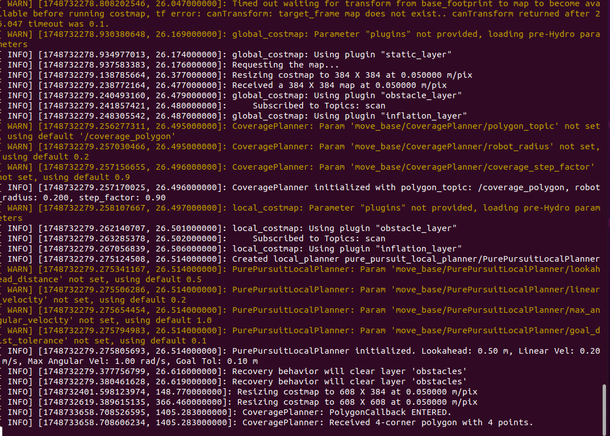
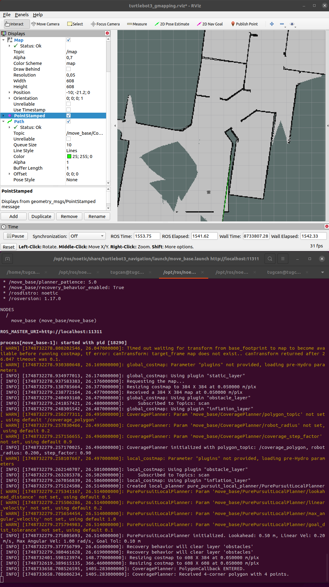
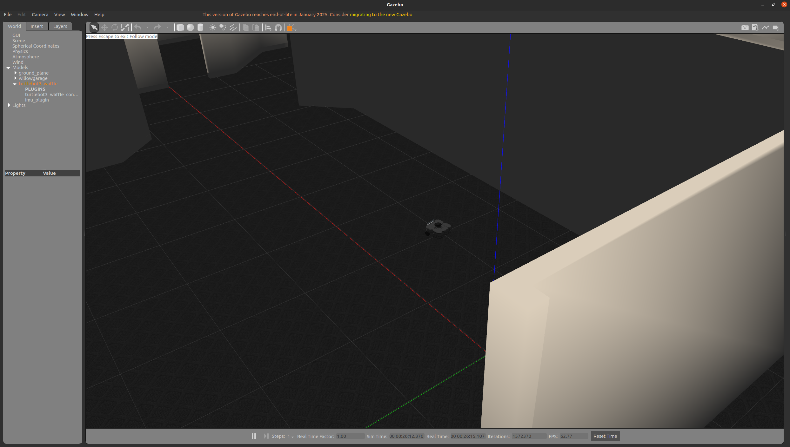
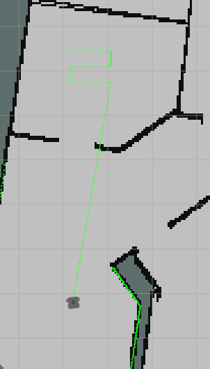
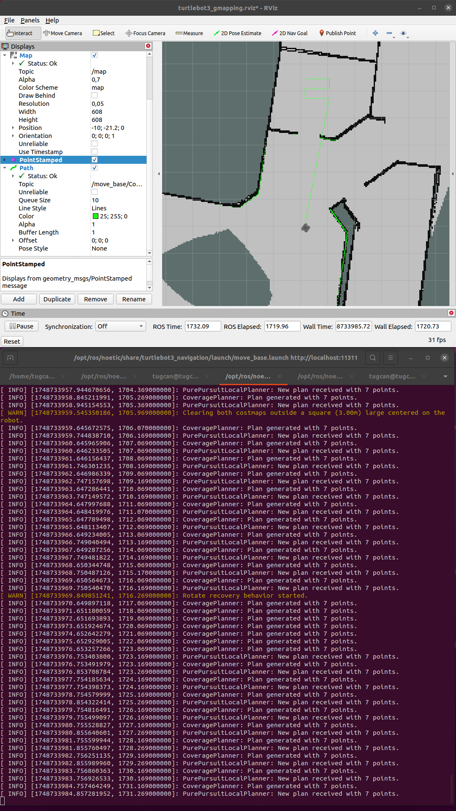
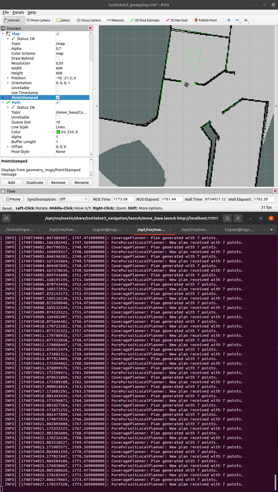
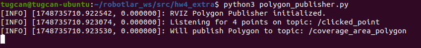

# ROS1 Navigation Plugins

ROS1 Catkin plugins developed for BLM6191 Robots, Assignment 4:

- `coverage_planner/CoveragePlanner` implements `nav_core::BaseGlobalPlanner`.
- `pure_pursuit_local_planner/PurePursuitLocalPlanner` implements `nav_core::BaseLocalPlanner` using Pure Pursuit path tracking.
- `hw4_extra/polygon_publisher.py` is a standalone ROS Python helper, not a Catkin package.

The global planner accepts four points and sweeps their axis-aligned bounding rectangle in a zigzag pattern. It shrinks that rectangle by `robot_radius` and spaces sweeps by `2 * robot_radius * coverage_step_factor`. It prepends the supplied start pose and publishes a `nav_msgs/Path`.

The local planner follows the Pure Pursuit algorithm described by R. Craig Coulter. It interpolates a lookahead point, transforms it into the robot frame, and computes curvature as `2 * y_error / L_actual^2`. It limits angular velocity, reduces speed near the final waypoint, and stops within the positional goal tolerance. Final orientation is not enforced.

## Build

Use a ROS1 environment with Catkin and the ROS navigation stack. These interfaces do not support ROS2. Copy the two package directories into an existing workspace:

```bash
source /opt/ros/noetic/setup.bash
mkdir -p ~/robotlar_ws/src
cp -r coverage_planner pure_pursuit_local_planner ~/robotlar_ws/src/
cd ~/robotlar_ws
rosdep install --from-paths src --ignore-src -r -y
catkin_make
source devel/setup.bash
```

Package dependencies are declared in each `package.xml`. The demo additionally needs TurtleBot3 Gazebo, SLAM, navigation and teleoperation packages. No robot description, costmap YAML, map, or complete simulation launch file is provided here.

## Configure move_base

Keep the existing robot-specific costmaps, TF configuration and map setup in your `move_base` launch file. Configure these parameters inside its existing node:

```xml
<node pkg="move_base" type="move_base" name="move_base" output="screen">
  <param name="base_global_planner" value="coverage_planner/CoveragePlanner"/>
  <param name="base_local_planner" value="pure_pursuit_local_planner/PurePursuitLocalPlanner"/>
  <param name="CoveragePlanner/polygon_topic" value="/coverage_area_polygon"/>
  <param name="CoveragePlanner/robot_radius" value="0.15"/>
  <param name="CoveragePlanner/coverage_step_factor" value="0.8"/>
  <param name="PurePursuitLocalPlanner/lookahead_distance" value="0.4"/>
  <param name="PurePursuitLocalPlanner/linear_velocity" value="0.15"/>
  <param name="PurePursuitLocalPlanner/max_angular_velocity" value="1.0"/>
  <param name="PurePursuitLocalPlanner/goal_dist_tolerance" value="0.05"/>
</node>
```

This fragment supplies plugin parameters only. The current implementation expects the node to be named `move_base` in the root namespace and reads parameters under `/move_base/<plugin-name>/`. Nested `<rosparam>` blocks containing XML `<param>` elements are not valid YAML configuration.

Defaults in the source are:

| Parameter | Default |
| --- | --- |
| `CoveragePlanner/polygon_topic` | `/coverage_polygon` |
| `CoveragePlanner/robot_radius` | `0.2` m |
| `CoveragePlanner/coverage_step_factor` | `0.9` |
| `PurePursuitLocalPlanner/lookahead_distance` | `0.5` m |
| `PurePursuitLocalPlanner/linear_velocity` | `0.2` m/s |
| `PurePursuitLocalPlanner/max_angular_velocity` | `1.0` rad/s |
| `PurePursuitLocalPlanner/goal_dist_tolerance` | `0.1` m |

## Simulation example

In separate terminals, source the workspace and launch the installed TurtleBot3 packages:

```bash
export TURTLEBOT3_MODEL=waffle
roslaunch turtlebot3_gazebo turtlebot3_willowgarage.launch
```

```bash
export TURTLEBOT3_MODEL=waffle
roslaunch turtlebot3_slam turtlebot3_slam.launch
```

```bash
export TURTLEBOT3_MODEL=waffle
roslaunch turtlebot3_teleop turtlebot3_teleop_key.launch
```

Build a map, then launch your configured `move_base`. Adapt the world and launch names to your installed TurtleBot3 version.

Publish a rectangle in the global costmap frame:

```bash
rostopic pub -1 /coverage_area_polygon geometry_msgs/Polygon \
  '{points: [{x: 1.0, y: 1.0, z: 0.0}, {x: 3.0, y: 1.0, z: 0.0}, {x: 3.0, y: 3.0, z: 0.0}, {x: 1.0, y: 3.0, z: 0.0}]}'
```

Alternatively, run the helper from this checkout:

```bash
python3 hw4_extra/polygon_publisher.py
```

Select four points with RViz's Publish Point tool. The helper publishes to `/coverage_area_polygon` by default, matching the explicit configuration above. Add `/move_base/CoveragePlanner/coverage_plan` in RViz, then send a 2D Nav Goal to request a plan. Each request generates a new sweep from the current start pose.

## Operational limits

- The planner uses the bounding rectangle, not the polygon interior. Rotated or irregular quadrilaterals can produce waypoints outside the selected polygon.
- The supplied navigation goal does not determine the coverage endpoint. The local planner follows the final coverage waypoint.
- The global planner does not check obstacles or the robot footprint against the costmap. The local planner does not check command trajectories for collisions. Keep validation in a controlled simulator before considering hardware use.
- The connection from the start pose to the first sweep is a straight segment. Positive radius and step settings do not establish that this connection is traversable or that every part of an arbitrary room is covered.
- Polygon messages have no frame header. Points and all input plan poses must already use the global costmap frame.

The screenshots below are historical assignment output. They are not evidence of a new simulator or hardware run during maintenance.











Maintenance validation uses compiled C++ regressions with isolated ROS, pose and TF boundaries for goal stopping, velocity reset, curvature during slowdown and failure paths. A full Catkin build, plugin loading, costmap integration, Gazebo run and physical robot behavior require a ROS1 environment and have separate acceptance requirements.
